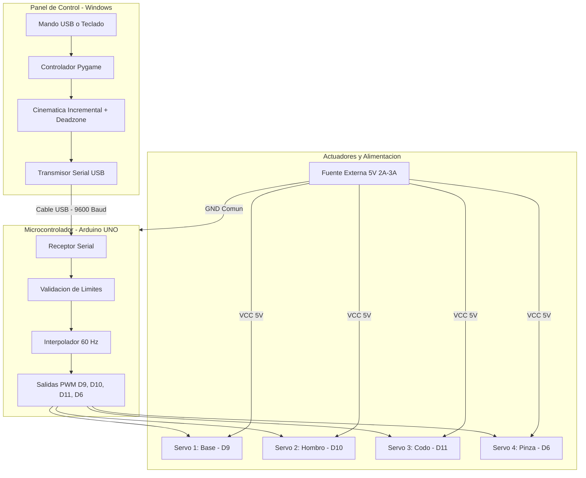

<div align="center">

<br>

# Grúa Robótica 4-DOF
### Control de Brazo Articulado con Joystick USB / Teclado y Arduino UNO

[](https://github.com/RodriA45/Grua-Robotica-4dof)
[](https://www.arduino.cc/)
[](https://www.python.org/)
[](https://www.pygame.org/)
[](LICENSE)
[](https://github.com/RodriA45/Grua-Robotica-4dof)

<p align="center">
  Sistema de control en tiempo real para brazo robótico articulado de 4 grados de libertad (4-DOF).<br>
  Incluye ejecutable portable independiente, soporte plug-and-play para mandos USB (PlayStation / genéricos), modo teclado interactivo y firmware con interpolación de movimiento suave.
</p>

[Capturas](#demostración-y-capturas) •
[Puesta en Marcha](#puesta-en-marcha) •
[Esquema Eléctrico](#esquema-eléctrico-y-alimentación) •
[Controles](#mapeo-de-controles) •
[Protocolo Serial](#protocolo-de-comunicación-serial)

</div>

---

## Tabla de Contenidos
- [Demostración y Capturas](#demostración-y-capturas)
- [Descripción General](#descripción-general)
- [Características Principales](#características-principales)
- [Arquitectura del Sistema](#arquitectura-del-sistema)
- [Esquema Eléctrico y Alimentación](#esquema-eléctrico-y-alimentación)
- [Mapeo de Controles](#mapeo-de-controles)
  - [Control con Joystick USB](#control-con-joystick-usb)
  - [Control con Teclado](#control-con-teclado)
- [Puesta en Marcha](#puesta-en-marcha)
  - [1. Carga del Firmware en Arduino](#1-carga-del-firmware-en-arduino)
  - [2. Ejecución del Panel de Control](#2-ejecución-del-panel-de-control)
- [Estructura del Repositorio](#estructura-del-repositorio)
- [Protocolo de Comunicación Serial](#protocolo-de-comunicación-serial)
- [Calibración y Ajustes](#calibración-y-ajustes)
- [Guía para Evaluadores](#guía-para-evaluadores)
- [Licencia](#licencia)

---

## Demostración y Capturas

<div align="center">

### 1. Panel de Control con Joystick Conectado
*Detección de modelo de mando (ej. DualSense), visualización de sticks con zona muerta y estados angulares:*


<br><br>

### 2. Panel de Control en Modo Teclado
*Activación automática ante la ausencia de joystick, con teclas interactivas iluminadas en tiempo real:*


<br><br>

### 3. Prototipo Físico del Brazo Robótico (4-DOF)
*Estructura mecánica con servomotores SG90 y mecanismo de pinza:*


</div>

---

## Descripción General

Este proyecto implementa una solución completa para operar un brazo robótico articulado impreso en 3D con 4 servomotores (SG90 / MG90S). El sistema se estructura en dos componentes:

1. **Panel de Control (PC - Windows):** Software en Python con interfaz gráfica en Pygame, empaquetado en un archivo ejecutable portable (`ControlGrua.exe`). Lee mandos analógicos y teclado, procesa zonas muertas y envía los ángulos de destino por puerto serie hacia el microcontrolador.
2. **Firmware de Control (Arduino UNO):** Programa en C++ que recibe las tramas seriales, valida los límites mecánicos de seguridad y aplica interpolación paso a paso a 60 Hz para garantizar un desplazamiento estable y sin tirones.

---

## Características Principales

- **Compatibilidad de Mandos:** Detección automática en caliente de controles USB (PlayStation 2/3/4/5, Xbox y mandos genéricos de PC).
- **Filtro de Zona Muerta (Deadzone):** Umbral configurable del 20% para anular la deriva (*drift*) generada por holguras mecánicas en las palancas.
- **Modo Teclado Automático:** Conmutación a control por teclado cuando no se detecta ningún mando, con respuesta visual en pantalla.
- **Ejecutable Standalone (`ControlGrua.exe`):** No requiere tener instalado Python ni librerías adicionales en la computadora del usuario o evaluador.
- **Reconexión Automática:** Búsqueda y enlace automático con el puerto COM de Arduino al momento de ser conectado.
- **Cinemática Suave:** Algoritmo de aproximación gradual que amortigua cambios bruscos de posición y reduce picos de consumo de corriente.
- **Modo Simulación:** Permite verificar la interfaz, cinemática y ángulos directamente en pantalla sin necesidad de tener el hardware físico conectado.

---

## Arquitectura del Sistema



---

## Esquema Eléctrico y Alimentación

> [!CAUTION]
> ### Regla de Alimentación:
> **No alimente los servomotores directamente desde el pin de 5V del Arduino UNO.**
>
> - El pin de 5V del Arduino suministra aproximadamente **400 mA** por USB.
> - Cada servo SG90 puede demandar entre **500 mA y 800 mA** bajo esfuerzo mecánico. Con 4 servos activos, la corriente total supera **1.5 A a 2.0 A**.
> - Alimentarlos desde la placa genera caídas de tensión (*brownout*), reinicios espontáneos del Arduino, vibraciones bruscas o daño en el regulador integrado.
>
> **Solución Requerida:** Utilice una fuente de alimentación externa de **5V (2A a 3A)** (ej. cargador USB de 5V, portapilas con 4 baterías recargables AA de 1.2V = 4.8V, o fuente regulada).
>
> **Masa Común:** Conecte el negativo (**GND**) de la fuente externa a uno de los pines **GND del Arduino**.

### Asignación de Pines

| Articulación | Pin Arduino UNO | Cable Señal | Rango Mecánico Seguro | Función |
| :--- | :---: | :---: | :---: | :--- |
| **Base** | `D9` | Naranja / Amarillo | `0° — 180°` | Rotación horizontal |
| **Hombro** | `D10` | Naranja / Amarillo | `20° — 160°` | Elevación del brazo inferior |
| **Codo** | `D11` | Naranja / Amarillo | `20° — 160°` | Extensión del antebrazo |
| **Pinza (Gripper)** | `D6` | Naranja / Amarillo | `15° — 115°` | Apertura y cierre |
| **Alimentación (+)** | *Fuente 5V Externa* | Rojo | `5.0V` | Tensión de trabajo de motores |
| **Masa (GND)** | *Fuente GND + Arduino GND* | Marrón / Negro | `0V` | Referencia común compartida |

---

## Mapeo de Controles

El sistema opera bajo control **incremental**: al mantener accionada una palanca o tecla, la articulación avanza suavemente hacia esa dirección; **al soltar el mando, la grúa permanece fija en la posición alcanzada**.

### Control con Joystick USB

| Mando / Botón | Acción | Articulación |
| :--- | :--- | :--- |
| **Stick Izquierdo (Eje X)** | Girar izquierda / derecha | **Base** |
| **Stick Izquierdo (Eje Y)** | Subir / bajar | **Hombro** |
| **Stick Derecho (Eje Y)** | Extender / recoger | **Codo** |
| **Botón Cruz (X) o L1** | Cerrar pinza gradualmente | **Pinza** |
| **Botón Círculo (O) o R1** | Abrir pinza gradualmente | **Pinza** |
| **Botón Triángulo** | Centrado (Home a 90°) | **Todos los ejes** |
| **Tecla V** | Alternar velocidad (Precisión / Rápido) | General |

### Control con Teclado

| Tecla Principal | Tecla Alternativa | Articulación | Acción |
| :---: | :---: | :--- | :--- |
| `←` / `→` | `A` / `D` | **Base** | Rotación izquierda / derecha |
| `↑` / `↓` | `W` / `S` | **Hombro** | Subir / bajar brazo |
| `Q` / `E` | `I` / `K` | **Codo** | Extender / recoger antebrazo |
| `ESPACIO` | `O` | **Pinza** | Abrir pinza |
| `ENTER` | `C` / `P` | **Pinza** | Cerrar pinza |
| `H` | — | **Home** | Posición neutral (90°) |
| `V` | — | **Velocidad** | Cambiar velocidad |

---

## Puesta en Marcha

### 1. Carga del Firmware en Arduino
1. Abra [Arduino IDE](https://www.arduino.cc/en/software).
2. Abra el archivo: [`grua_arduino/grua_arduino.ino`](grua_arduino/grua_arduino.ino).
3. Conecte el Arduino UNO por cable USB a la computadora.
4. En **Herramientas**:
   - **Placa:** *Arduino Uno*
   - **Puerto:** Seleccione el puerto COM asignado.
5. Presione **Subir** (Upload).

### 2. Ejecución del Panel de Control
- **Opción recomendada:** Ejecute directamente el archivo portable [`ControlGrua.exe`](ControlGrua.exe). No requiere instalar Python ni librerías.
- **Con script lanzador:** Doble clic en [`iniciar_control.bat`](iniciar_control.bat).
- **Desde código fuente:**
  ```powershell
  python -m venv .venv
  .\.venv\Scripts\pip install -r requirements.txt
  .\.venv\Scripts\python control_joystick.py
  ```

---

## Estructura del Repositorio

```text
Grua-Robotica-4DOF/
│
├── ControlGrua.exe             # Ejecutable standalone empaquetado (sin dependencias)
├── iniciar_control.bat         # Script lanzador automático para Windows
├── actualizar_desde_github.bat # Script para sincronizar con GitHub en un clic
├── README.md                   # Documentación técnica del proyecto
├── LICENSE                     # Licencia abierta MIT
│
├── control_joystick.py         # Código fuente en Python (GUI Pygame + Serial)
├── requirements.txt            # Dependencias del proyecto
├── .gitignore                  # Exclusiones de control de versiones
│
├── assets/                     # Recursos gráficos y multimedia
│   ├── icono.ico
│   ├── icono.png
│   ├── screenshot_joystick.png
│   ├── screenshot_teclado.png
│   └── foto_brazo.jpg
│
└── grua_arduino/
    └── grua_arduino.ino        # Firmware para microcontrolador Arduino UNO
```

---

## Protocolo de Comunicación Serial

La comunicación entre el PC y el Arduino se realiza mediante puerto serie a **9600 baudios**:

- **Trama de posición:**  
  `"<Base,Hombro,Codo,Pinza>\n"`  
  *Ejemplo:* `"<90,120,80,45>\n"` (Posiciona Base=90°, Hombro=120°, Codo=80°, Pinza=45°).
- **Comando de Centrado (Home):**  
  `"HOME\n"` (Retorna todos los servos a 90° de manera coordinada).

El microcontrolador procesa la trama en un buffer no bloqueante, restringe los valores a los topes físicos con `constrain()` y traslada la posición actual a una frecuencia de **60 Hz** (cada 15 ms).

---

## Calibración y Ajustes

Si requiere invertir el sentido de giro de alguna articulación o modificar los topes mecánicos, edite las siguientes variables en [`control_joystick.py`](control_joystick.py):

```python
# 1. Invertir sentido de giro según el ensamble físico
INVERTIR = {
    "base":   False,
    "hombro": True,
    "codo":   False,
    "pinza":  False,
}

# 2. Límites angulares y velocidad en grados/segundo
LIMITES = {
    "base":   {"min": 0.0,  "max": 180.0, "inicial": 90.0, "vel": 50.0},
    "hombro": {"min": 20.0, "max": 160.0, "inicial": 90.0, "vel": 45.0},
    "codo":   {"min": 20.0, "max": 160.0, "inicial": 90.0, "vel": 45.0},
    "pinza":  {"min": 15.0, "max": 115.0, "inicial": 90.0, "vel": 70.0},
}
```

---

## Guía para Evaluadores

Para la evaluación y prueba a distancia de este proyecto:

1. No se requiere instalar entornos de desarrollo ni paquetes externos.
2. Descomprima la carpeta del proyecto en una computadora con Windows.
3. Ejecute directamente el archivo **`ControlGrua.exe`**.
4. Si no cuenta con el hardware conectado, el programa iniciará en **Modo Simulación**, permitiendo interactuar con los medidores gráficos mediante las **flechas del teclado** o un mando USB.

---

## Licencia

Distribuido bajo la Licencia **MIT**. Consulte el archivo `LICENSE` para más información. Proyecto orientado a aplicaciones educativas y robótica de código abierto.
