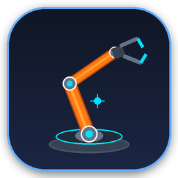
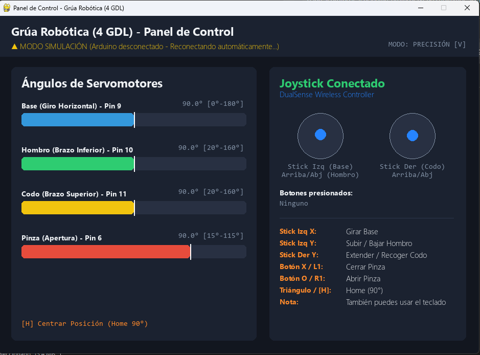
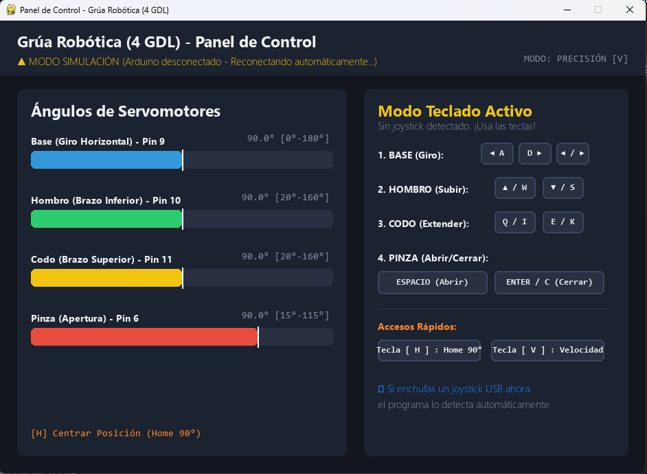
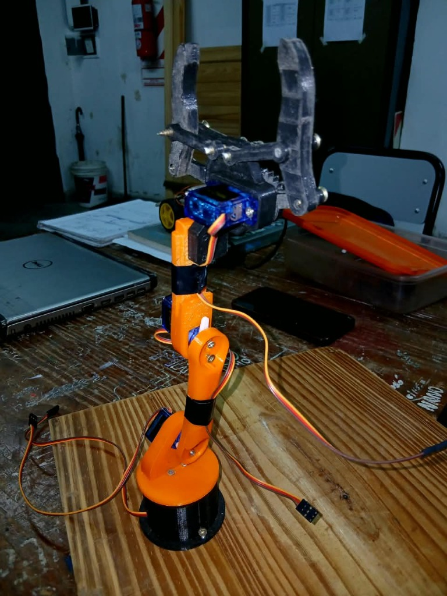

<div align="center">

<br>

# 🦾 Grúa Robótica 4-DOF
### Control de Brazo Articulado con Joystick USB / Teclado y Arduino UNO

[](https://github.com/RodriA45/Grua-Robotica-4dof)
[](https://www.arduino.cc/)
[](https://www.python.org/)
[](https://www.pygame.org/)
[](LICENSE)
[](https://github.com/RodriA45/Grua-Robotica-4dof)

<p align="center">
  Sistema integral de control en tiempo real para brazos robóticos y grúas de 4 grados de libertad (4-DOF).<br>
  Incluye <b>ejecutable portable con icono personalizado</b>, soporte plug-and-play para <b>mandos de PlayStation y genéricos USB</b>, modo teclado interactivo y <b>firmware con interpolación de movimiento suave</b>.
</p>

[📸 Capturas](#-capturas-de-pantalla-y-demostración) •
[Puesta en Marcha](#-puesta-en-marcha-rápida) •
[Diagrama Eléctrico](#-esquema-eléctrico-y-alimentación) •
[Controles](#-mapeo-de-controles) •
[Protocolo Serial](#-protocolo-de-comunicación-serial)

</div>

---

## 📋 Tabla de Contenidos
- [📸 Capturas de Pantalla y Demostración](#-capturas-de-pantalla-y-demostración)
- [Descripción General](#-descripción-general)

- [Características Principales](#-características-principales)
- [Arquitectura del Sistema](#-arquitectura-del-sistema)
- [Esquema Eléctrico y Alimentación](#-esquema-eléctrico-y-alimentación)
- [Mapeo de Controles](#-mapeo-de-controles)
  - [Control con Joystick USB](#control-con-joystick-usb-playstation--genérico)
  - [Modo Teclado Interactivo](#modo-teclado-interactivo-sin-mando)
- [Puesta en Marcha Rápida](#-puesta-en-marcha-rápida)
  - [1. Carga del Firmware en Arduino](#1-carga-del-firmware-en-arduino)
  - [2. Ejecución en la PC](#2-ejecución-en-la-pc)
- [Estructura del Repositorio](#-estructura-del-repositorio)
- [Protocolo de Comunicación Serial](#-protocolo-de-comunicación-serial)
- [Calibración y Ajustes](#-calibración-y-ajustes)
- [Guía Rápida para Profesores / Evaluadores](#-guía-rápida-para-profesores--evaluadores)
- [Licencia](#-licencia)

---

## 📸 Capturas de Pantalla y Demostración

<div align="center">

### 🎮 1. Modo Joystick Conectado (DualSense / PlayStation / Genérico USB)
*Detecta el modelo exacto del mando, dibuja las palancas analógicas con filtrado de zona muerta y visualiza botones activos:*



<br><br>

### ⌨️ 2. Modo Teclado Interactivo (Detección automática sin mando)
*Si no hay ningún joystick enchufado, se despliegan teclas interactivas que se iluminan en tiempo real al presionarlas:*



<br><br>

### 🦾 3. Brazo Robótico Articulado Físico (4 Grados de Libertad)
*Estructura impresa en 3D con microservos SG90 / MG90S, pinza mecánica y control de giro horizontal:*



</div>

---

## 📌 Descripción General

Este proyecto implementa una solución completa de hardware y software para operar un brazo robótico articulado impreso en 3D con 4 microservomotores (**SG90** / **MG90S**). La arquitectura divide el esfuerzo en dos capas:

1. **Capa de Control e Interfaz (PC - Windows):** Un panel de instrumentos desarrollado en Python y empaquetado en un ejecutable autónomo (`.exe`). Gestiona las entradas de mandos analógicos USB y teclados, filtra ruidos y deriva cinemática mediante zonas muertas (*deadzone*), y transmite las coordenadas angulares absolutas por puerto serie.
2. **Capa de Actuación y Seguridad (Arduino UNO):** Firmware en C++ encargado del control PWM de los servomotores, aplicando límites mecánicos de protección (*soft limits*) y un algoritmo de aceleración/interpolación suave que previene esfuerzos destructivos sobre los engranajes plásticos.

---

## ✨ Características Principales

- 🎮 **Plug-and-Play para Joysticks USB:** Detección en caliente (*hotplug*) de mandos originales de PlayStation (PS2 con adaptador, PS3, PS4, PS5), Xbox y mandos genéricos o clones de PC.
- 🎯 **Filtro de Zona Muerta (Deadzone):** Umbral configurable del 20% para anular el *stick drift* típico de los mandos económicos con holgura mecánica.
- ⌨️ **Modo Teclado Interactivo:** Si no hay ningún joystick enchufado, se activa una interfaz visual con teclas en pantalla que se iluminan en tiempo real al ser presionadas.
- 🚀 **Ejecutable Standalone (`ControlGrua.exe`):** No requiere que el usuario o evaluador instale Python, librerías, Git ni controladores especiales.
- 🔄 **Reconexión Serial Automática:** Si el Arduino se conecta después de abrir el programa, este lo detecta y sincroniza automáticamente sin bloquear la interfaz.
- 🛡️ **Cinemática Suave y Segura:** Algoritmo paso a paso de velocidad acotada que evita caídas de tensión bruscas y golpes de inercia que desestabilicen la base.
- 🧪 **Modo Simulación Integrado:** Permite evaluar el software, cinemática y ángulos visualmente incluso si no se cuenta con el hardware físico presente.

---

## 📐 Arquitectura del Sistema

```mermaid
graph TD
    subgraph PC ["Computadora (Panel de Control)"]
        Joy["Joystick USB (PS / Genérico)"] --> App["ControlGrua (Pygame GUI)"]
        Key["Teclado (Flechas / WASD)"] --> App
        App --> Kin["Cálculo Cinemático Incremental + Deadzone"]
        Kin --> SerialTX["Transmisor Serial USB (9600 Baud)"]
    end

    subgraph Arduino ["Microcontrolador (Arduino UNO)"]
        SerialRX["Receptor Serial (Buffer no bloqueante)"]
        Limites["Validación de Límites Mecánicos"]
        Suavizado["Interpolador Suave (60 Hz)"]
        PWM["Salidas PWM (Timer Hardware)"]
        
        SerialTX -->|Cable USB| SerialRX
        SerialRX --> Limites
        Limites --> Suavizado
        Suavizado --> PWM
    end

    subgraph Actuadores ["Brazo Físico"]
        PWM -->|Pin 9| S1["Servo Base (0° - 180°)"]
        PWM -->|Pin 10| S2["Servo Hombro (20° - 160°)"]
        PWM -->|Pin 11| S3["Servo Codo (20° - 160°)"]
        PWM -->|Pin 6| S4["Servo Pinza (15° - 115°)"]
        
        Power["Fuente Externa 5V 2A-3A"] ===|VCC (+5V)| S1 & S2 & S3 & S4
        Power ===|GND Común| Arduino
    end
```

---

## ⚡ Esquema Eléctrico y Alimentación

> [!CAUTION]
> ### REGLA CRÍTICA DE ALIMENTACIÓN:
> **NO alimente los servomotores directamente desde el pin `5V` del Arduino UNO.**
>
> - El regulador integrado del Arduino y el puerto USB de la PC solo pueden suministrar un promedio de **400 mA**.
> - Cada servo SG90 puede demandar picos de hasta **800 mA** bajo esfuerzo mecánico. Con 4 motores operando en simultáneo, el consumo supera **1.5 A - 2.0 A**.
> - Si se conectan al Arduino, se producirán caídas de tensión (*brownouts*), reinicios aleatorios de la placa, vibraciones violentas (*jitter*) o daño en el microcontrolador.
>
> **Solución Requerida:** Utilice una fuente de poder externa de **5V (2A a 3A)** (ej. cargador de celular intervenido, portapilas con 4 baterías recargables AA de 1.2V = 4.8V, o módulo elevador/reductor).
>
> **Masa Común:** Conecte el negativo (**GND**) de la fuente externa a uno de los pines **GND del Arduino**.

### Tabla de Cableado de Señales

| Articulación | Pin Arduino UNO | Cable Servo | Rango Seguro | Función Mecánica |
| :--- | :---: | :---: | :---: | :--- |
| **Base** | `D9` | Naranja / Amarillo | `0° — 180°` | Rotación azimutal horizontal |
| **Hombro** | `D10` | Naranja / Amarillo | `20° — 160°` | Elevación del brazo primario |
| **Codo** | `D11` | Naranja / Amarillo | `20° — 160°` | Extensión del antebrazo |
| **Pinza (Gripper)** | `D6` | Naranja / Amarillo | `15° — 115°` | Apertura y cierre de mordazas |
| **Alimentación (+)** | *Fuente 5V Externa* | Rojo | `5.0V` | Tensión de trabajo de motores |
| **Masa (GND)** | *Fuente GND + Arduino GND* | Marrón / Negro | `0V` | Referencia común compartida |

---

## 🎮 Mapeo de Controles

El control implementa una filosofía **incremental**: al inclinar una palanca o mantener una tecla pulsada, la articulación se desplaza suavemente hacia esa dirección; **al soltar el mando, la grúa permanece fija en la posición alcanzada**.

### Control con Joystick USB (PlayStation / Genérico)

| Mando / Botón | Acción Realizada | Articulación Afectada |
| :--- | :--- | :--- |
| **Stick Izquierdo (Eje X)** | Girar izquierda / derecha | **Base** |
| **Stick Izquierdo (Eje Y)** | Subir / bajar | **Hombro** |
| **Stick Derecho (Eje Y)** | Extender / retraer | **Codo** |
| **Botón ❌ (Cruz) o L1** | Cerrar pinza gradualmente | **Pinza** |
| **Botón ⭕ (Círculo) o R1** | Abrir pinza gradualmente | **Pinza** |
| **Botón 🔺 (Triángulo)** | Retorno a posición neutral (90°) | **Todos (Home)** |
| **Tecla `V`** | Alternar velocidad (Precisión / Rápido) | Sistema |

### Modo Teclado Interactivo (Sin Mando)

Si no se conecta ningún mando analógico, el sistema conmuta a visualización de teclado en vivo:

| Teclas Primarias | Teclas Alternativas | Articulación | Comportamiento |
| :---: | :---: | :--- | :--- |
| `←` / `→` | `A` / `D` | **Base** | Rotación izquierda / derecha |
| `↑` / `↓` | `W` / `S` | **Hombro** | Elevación arriba / abajo |
| `Q` / `E` | `I` / `K` (o `RePág`/`AvPág`) | **Codo** | Extensión adelante / atrás |
| `ESPACIO` | `O` | **Pinza** | Apertura de mordazas |
| `ENTER` | `C` / `P` | **Pinza** | Cierre de mordazas |
| `H` | — | **Home** | Restablece todos los ejes a 90° |
| `V` | — | **Velocidad** | Cambia multiplicador de velocidad |

---

## 🚀 Puesta en Marcha Rápida

### 1. Carga del Firmware en Arduino
1. Instale y abra [Arduino IDE](https://www.arduino.cc/en/software).
2. Abra el proyecto: [`grua_arduino/grua_arduino.ino`](grua_arduino/grua_arduino.ino).
3. Conecte el Arduino UNO mediante el cable USB a la computadora.
4. En el menú superior de Arduino IDE:
   - **Herramientas > Placa:** *Arduino Uno*
   - **Herramientas > Puerto:** Seleccione el puerto COM asignado (ej. `COM3`, `COM4`).
5. Haga clic en el botón **Subir** (ícono de flecha hacia la derecha).

### 2. Ejecución en la PC
Elija la opción que prefiera:

- 🌟 **Opción 1 (Directa / Sin Instalar Nada):**  
  Haga doble clic en el archivo precompilado [`ControlGrua.exe`](ControlGrua.exe).
- ⚙️ **Opción 2 (Lanzador Batch):**  
  Haga doble clic en [`iniciar_control.bat`](iniciar_control.bat).
- 🐍 **Opción 3 (Código Fuente Python):**  
  Si desea ejecutar o modificar el código fuente directamente:
  ```powershell
  python -m venv .venv
  .\.venv\Scripts\pip install -r requirements.txt
  .\.venv\Scripts\python control_joystick.py
  ```

---

## 📁 Estructura del Repositorio

```text
Grua-Robotica-4DOF/
│
├── ControlGrua.exe             # Ejecutable standalone empaquetado (sin dependencias)
├── iniciar_control.bat         # Script lanzador automático para Windows
├── actualizar_desde_github.bat # Script para sincronizar con 'git pull' en un clic
├── README.md                   # Documentación técnica completa (este archivo)
├── LICENSE                     # Licencia abierta MIT
│
├── control_joystick.py         # Código fuente en Python (GUI Pygame + Serial)
├── requirements.txt            # Dependencias Python (pygame, pyserial, pyinstaller)
├── .gitignore                  # Reglas de exclusión para control de versiones
│
├── assets/                     # Iconos, capturas de pantalla y fotos del robot
│   ├── icono.ico
│   ├── icono.png
│   ├── screenshot_joystick.png
│   ├── screenshot_teclado.png
│   └── foto_brazo.jpg
│
└── grua_arduino/
    └── grua_arduino.ino        # Sketch C++ para microcontrolador Arduino UNO
```


---

## 📡 Protocolo de Comunicación Serial

La comunicación entre el controlador Python y el Arduino se efectúa mediante un enlace serie a **9600 baudios**, con tramas basadas en texto delimitadas por saltos de línea:

- **Formato de trama de posición:**  
  `"<Base,Hombro,Codo,Pinza>\n"`  
  *Ejemplo:* `"<90,120,80,45>\n"` (Posiciona Base=90°, Hombro=120°, Codo=80°, Pinza=45°).
- **Comando de Centrado (Home):**  
  `"HOME\n"`  
  Provoca el retorno coordinado de todos los servomotores a 90°.
- **Respuesta de confirmación (Eco opcional):**  
  `"ACK: HOME\n"`

El algoritmo en el microcontrolador analiza la trama mediante un buffer continuo no bloqueante, aplica las restricciones `constrain()` contra los topes definidos y traslada gradualmente las variables actuales hacia el objetivo a una tasa de actualización de **60 Hz** (cada 15 ms).

---

## 🔧 Calibración y Ajustes

Si al armar el brazo mecánico los movimientos resultan invertidos respecto a su preferencia, o las garras aprietan con demasiada fuerza, modifique estas variables en el archivo [`control_joystick.py`](control_joystick.py):

```python
# 1. Invertir sentido de giro según el montaje de sus motores
INVERTIR = {
    "base":   False,  # Cambiar a True para invertir el giro
    "hombro": True,   # Cambiar a False si el hombro sube al revés
    "codo":   False,  # Cambiar a True para invertir el antebrazo
    "pinza":  False,
}

# 2. Ajustar topes mínimos y máximos para proteger los engranajes
LIMITES = {
    "base":   {"min": 0.0,  "max": 180.0, "inicial": 90.0, "vel": 50.0},
    "hombro": {"min": 20.0, "max": 160.0, "inicial": 90.0, "vel": 45.0},
    "codo":   {"min": 20.0, "max": 160.0, "inicial": 90.0, "vel": 45.0},
    "pinza":  {"min": 15.0, "max": 115.0, "inicial": 90.0, "vel": 70.0}, # min=cerrado, max=abierto
}
```

---

## 🎓 Guía Rápida para Profesores / Evaluadores

Para facilitar la corrección y evaluación a distancia de este proyecto:

1. **No requiere instalar ningún entorno ni paquete adicional.**
2. Descomprima la carpeta recibida en cualquier PC con Windows.
3. Ejecute directamente el archivo **`ControlGrua.exe`**.
4. Si no dispone del brazo físico conectado, el software iniciará en **Modo Simulación**, permitiendo interactuar con los medidores gráficos mediante las **flechas del teclado** o mandos de juegos.


---

## 📄 Licencia

Distribuido bajo la Licencia **MIT**. Consulte el archivo `LICENSE` o el código fuente para más información. Proyecto de código abierto orientado a fines educativos y de robótica aplicada.
